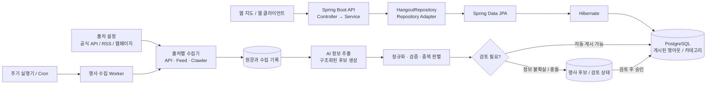

# 서비스 아키텍처

## 목표

Hangout Brochure는 한국에서 열리는 행사 정보를 여러 출처에서 모아 정리하고, 웹 클라이언트가 행아웃과 카테고리를 조회할 수 있게 제공한다.

핵심 흐름은 두 가지다.

1. **조회 흐름**: 웹 클라이언트가 API를 통해 검증·게시된 행아웃을 조회한다.
2. **수집 흐름**: 주기적으로 외부 출처를 확인하고, 행사 정보를 후보 데이터로 추출·정규화한 뒤 DB에 반영한다.

조회 API는 안정적인 서비스 경로로 유지하고, 크롤링과 AI 처리 작업은 별도의 수집 흐름으로 둔다. 수집 실패나 외부 사이트 지연이 API 응답을 막지 않도록 분리한다.

## 전체 흐름



이 그림에서 **API와 DB의 행아웃·카테고리 조회 경로는 현재 구현되어 있다.** 수집 Worker부터 후보 검토와 게시까지는 목표 구조이며, 아직 구현되지 않았다.

## 현재 구현 구조

```text
controller
├── HangoutBrochureController
├── advice
└── dto
    ├── request
    └── response
        └── error

service
├── HangoutService
└── HangoutCategoryService

domain
├── Hangout / HangoutCategory
└── 조회 Criteria 및 결과

repository
├── HangoutRepository                 # 서비스가 의존하는 조회 인터페이스
├── HangoutRepositoryAdapter          # JPA Entity를 domain 모델로 변환
└── jpa
    ├── HangoutJpaRepository
    ├── HangoutCategoryJpaRepository
    └── entity
        ├── HangoutEntity
        └── HangoutCategoryEntity
```

ㅋ## 수집기 코드 배치와 실행 방식

수집 기능은 공개 조회용 `controller / service / repository`와 나란히 `command`와 `ingestion`으로 둔다. `command`는 실행 진입점과 옵션 선택을, `ingestion`은 출처별 수집 동작을 담당한다.

```text
command
└── ingestion
    ├── IngestCommand       # --app.command=ingest 진입점
    ├── persistence
    │   └── IngestionPersistence # 실행 이력과 원문 upsert
    └── source
        ├── IngestionSource # 출처 수집기의 공통 계약
        └── seoulCulturalEvent
            ├── SeoulCulturalEventClient   # 서울 문화행사 API 호출·페이지 처리
            ├── SeoulCulturalEventRecord   # 출처 응답을 정규화한 레코드
            └── SeoulCulturalEventIngestionSource # 수집 실행 구현

ingestion.application      # 수집 조정, 중복 판별, 저장 (추가 시)
ingestion.persistence      # 원문/후보/체크포인트 저장 (추가 시)
```

cron이 Spring 애플리케이션 안에서 계속 돌도록 하기보다, 초기에 **한 번 실행 후 종료하는 명령**을 만들고 OS cron이나 컨테이너 스케줄러가 정해진 주기에 호출하는 편이 운영과 재시도에 편하다. API 서버와 수집 작업도 각각 따로 실행할 수 있다. 출처 어댑터는 수집 로직만 맡고, command는 설정을 읽어 수집 흐름을 시작하는 역할을 한다.

서울시 문화행사 데이터는 [서울시 문화행사 정보](https://data.seoul.go.kr/dataList/OA-23041/S/1/datasetView.do)의 항목을 `ingestion_raw_seoul_cultural_hangouts`에 저장한다. API 응답 필드를 프로젝트 이름으로 매핑해 보존하며, `ingestion_sources`에는 `seoul-cultural-events` 출처를 등록한다. `command.ingestion.IngestCommand`가 `--source` 이름에 맞는 `IngestionSource`를 선택하고, 서울 문화행사 수집 구현은 `command.ingestion.source.seoulCulturalEvent` 패키지에 둔다. `cultcode` 고유 키로 재수집을 멱등하게 처리하며, 실행 결과는 `ingestion_runs`에 기록한다. 수집 원문은 아직 후보 검증 후 공개 행아웃으로 승격하지 않는다.

현재 명령은 `SEOUL_OPEN_API_KEY`를 `.env.local`에 둔 상태에서 다음처럼 실행한다. 설정 계층은 [README](../README.md#configuration)를 참고한다.

```bash
./gradlew bootRun --args='--spring.main.web-application-type=none --app.command=ingest --source=seoul-cultural-events'
```

여러 출처를 한 번에 실행하려면 `--source=...` 옵션을 반복한다. 예를 들어 `--source=seoul-cultural-events --source=another-source`처럼 지정할 수 있다.

개발 단계에서는 이 명령을 직접 실행해 결과를 확인하고, 운영에서는 동일한 명령을 컨테이너 작업으로 패키징해 cron이 호출하게 한다. 실행 주기는 열린데이터광장에 명시된 일 1회 갱신에 맞춰 하루 한 번부터 시작할 수 있다.

조회 요청은 `Controller → Service → HangoutRepository → JPA Repository → Hibernate → PostgreSQL` 순서로 처리한다. Controller는 HTTP DTO를 받고, Service는 조회 조건과 페이지 결과를 다루며, Adapter는 JPA Entity를 API에 독립적인 domain 모델로 변환한다.

현재 API:

- `GET /api/hangouts`: 카테고리와 겹치는 일정 범위로 행아웃을 필터링하고 UUID 커서로 조회한다.
- `GET /api/hangout-categories`: 카테고리 코드나 이름의 부분 문자열을 검색하고 정수 ID 커서로 조회한다.

## 목표 수집 흐름

### 1. 출처별 수집기와 증분 처리

출처에 따라 전용 Adapter를 둔다.

- **공식 API**: 공공기관·행사 플랫폼이 API를 제공하면 우선 사용한다. 인증 키는 코드나 DB에 저장하지 않고 환경 변수 또는 Secret으로 관리한다.
- **RSS / 뉴스 피드**: 새 기사와 행사 공지를 찾는 용도로 사용하고, 원문 URL과 발행 정보를 보존한다.
- **웹페이지 크롤러**: 공식 행사 페이지 등 출처별 페이지 구조를 파싱한다. 출처의 이용 조건과 요청 제한을 지키고, 페이지 구조 변경이나 실패를 출처별로 격리한다.

출처별 수집기는 원문을 `Hangout`으로 바로 만들지 않는다. 원문 위치, 출처 식별자, 수집 시각, 외부 ID와 함께 보관하거나 재처리할 수 있게 남긴다.

수집기와 AI 추출기는 **책임을 나눈 논리 단계**이지, 처음부터 별도 프로세스나 서비스로 배포해야 한다는 뜻은 아니다. 초기에는 RSS 수집기가 원문을 가져온 뒤 공통 추출기를 호출해 한 Worker 작업 안에서 처리해도 된다. 공식 API처럼 이미 구조화된 데이터는 AI 추출을 건너뛰고 필드 변환을 할 수 있다.

각 API, RSS 피드, 크롤링 대상은 **별도의 수집 체크포인트**를 가진다. 한 출처의 진행 상태를 다른 출처와 공유하지 않는다.

- **공식 API**: `updated_at` 같은 변경 시각이나 페이지 토큰을 우선 사용한다. 처음에는 전체/기간 조회를 하고, 이후 성공한 체크포인트부터 이어 읽는다.
- **RSS**: 항목의 `guid`를 우선 식별자로 사용하고 없으면 정규화한 링크를 사용한다. `ETag` / `Last-Modified`가 지원되면 다음 요청에 활용한다. 발행 시각은 늦게 추가되거나 수정될 수 있으므로 그것만 믿지 않고, 매 실행마다 최근 구간을 겹쳐 읽은 뒤 중복 제거한다.
- **웹페이지 크롤링**: sitemap이나 목록의 갱신 시각이 있으면 활용한다. 없으면 정해진 범위를 주기적으로 다시 확인하고, URL과 내용 해시로 새 글·수정 글을 판별한다.

수집과 AI 처리는 진행 상태를 분리한다.

1. 출처에서 발견한 원문을 `ingestion_raw_seoul_cultural_hangouts` 등 출처별 원문 테이블에 먼저 저장한다. 출처가 제공하는 안정적인 고유 ID(서울 문화행사는 `cultcode`)에 고유 제약을 두어 같은 항목이 반복 발견돼도 중복 저장되지 않게 한다.
2. 원문 저장이 성공한 뒤 출처 체크포인트를 갱신한다. 이렇게 하면 AI 처리에 실패해도 다음 실행에서 원문을 잃지 않는다.
3. Worker는 아직 처리되지 않았거나 원문 해시가 바뀐 문서를 AI 추출 대상으로 가져온다. 실패한 문서는 재시도하고 성공·검토 대기·실패 상태를 기록한다.
4. 같은 원문과 같은 추출기 버전으로 이미 처리한 문서는 건너뛴다. 프롬프트나 추출 스키마를 바꾸어 재추출할 때는 추출기 버전을 바꾸어 대상 문서를 다시 처리할 수 있게 한다.

수집 체크포인트는 “어디까지 원문을 저장했는가”를 나타내고, 문서 처리 상태는 “AI 추출과 검증이 어디까지 됐는가”를 나타낸다. 행사의 `starts_at`은 출처 처리 진행 위치가 아니므로 증분 수집 기준으로 사용하지 않는다.

### 2. AI 정보 추출

AI는 원문에서 행사 후보 필드를 추출하는 보조 도구로 사용한다. 예를 들면 다음과 같다.

- 행사명과 설명
- 시작·종료 일시
- 장소명, 주소, 좌표 후보
- 카테고리 후보
- 공식 행사 URL과 근거 문장
- 필드별 신뢰도 또는 검토 사유

AI 결과는 구조화된 후보로 저장하고 곧바로 공개 API에 노출하지 않는다. 필수 정보 누락, 날짜 모순, 낮은 신뢰도, 서로 다른 출처의 충돌이 있으면 검토 대상으로 둔다. 충분히 검증된 항목만 게시된 행아웃으로 반영한다.

### 3. 정규화와 중복 제거

- 내부 카테고리 코드(`music`, `sport` 등)로 매핑하고, 출처의 분류명은 그대로 내부 카테고리로 사용하지 않는다.
- 한국 출처에서 시간대가 생략된 일시는 `Asia/Seoul` 기준으로 해석한다. 시간대가 명시된 값은 해당 offset을 존중하고, DB에는 시점을 보존한다.
- 출처의 외부 ID와 행사명·일시·장소·주최 조합을 이용해 중복 후보를 찾는다. 서울 문화행사는 `cultcode`가 고유하지만 같은 행사가 다른 `cultcode`로 두 번 등재되는 경우가 있어, `content_hash`로 묶어 정본을 고른다.
- 같은 행사가 여러 출처에서 발견되면 출처 링크를 모두 보존하고, 최신 정보와 신뢰도에 따라 정본을 갱신한다.
- 수집 재시도에도 중복 행이 만들어지지 않도록 수집 반영은 멱등하게 설계한다.

## 목표 데이터 책임

현재 PostgreSQL에는 공개 조회에 사용하는 `hangouts`, `hangout_categories`, `hangout_category_assignments`가 있다. 수집 기능을 추가할 때는 공개용 데이터와 수집 중간 데이터를 구분한다.

### `hangouts` 필드

공개 API가 그대로 내보내는 테이블이다. 수집 원문(raw)과 달리 **정제를 통과한 값만** 들어오며, 출처가 주지 않은 값은 NULL로 둔다. 거짓 값을 채워 넣지 않는다.

| 컬럼 | 의미 |
| --- | --- |
| `id` | 행아웃 PK (`uuidv7`) |
| `source_name` | 어느 출처에서 왔는지. `ingestion_sources` FK. 수집으로 들어오지 않은 행도 출처를 밝힌다 — 로컬 샘플은 `mock-data`라는 `seed` 출처를 쓰며, 수집 대상이 아니므로 `enabled = false`다 |
| `source_raw_id` | 원본 raw 행의 UUID. **정제의 멱등 키**로, UNIQUE라 같은 원문이 두 번 승격되지 않는다. raw가 없는 행(샘플·수동 등록)은 NULL이며 Postgres는 NULL끼리 충돌시키지 않는다 |
| `detail_url` | 출처의 상세 페이지 링크. 목록에서 원문으로 넘어가는 용도 |
| `title` | 행사명 |
| `location_name` | 장소명. 서울 문화행사는 raw `place`에서 온다 |
| `address` | 도로명 주소. 서울 문화행사에는 주소 필드가 없어 대부분 NULL이다 |
| `district` | 자치구. 지역 필터의 축 |
| `latitude`, `longitude` | 좌표. 지도 마커의 위치라 **NOT NULL이며, 좌표가 없는 원문은 정제에서 제외**한다 |
| `start_date`, `end_date` | 행사 기간. **날짜 단위다.** 출처가 날짜만 주므로 시각을 지어내지 않는다 |
| `event_time_desc` | `19:30`·`프로그램별 상이`처럼 날짜로 표현되지 않는 시간 정보. 자유 텍스트이며 **표시 전용으로 파싱하지 않는다** |
| `organizer` | 주최·주관 기관 |
| `image_url` | 대표 이미지 |
| `is_free` | 무료 여부. 불명확하면 NULL |
| `fee_desc` | `전석 20,000원` 같은 요금 문자열 |
| `contact` | 문의처 |
| `status` | `PUBLISHED` / `REVIEW` / `HIDDEN`. 날짜가 역전되는 등 품질이 의심스러운 행을 지우지 않고 숨겨둘 수 있다. 목록 API는 `PUBLISHED`만 반환한다 |
| `created_at`, `updated_at` | 생성·갱신 시각. 재정제로 내용이 바뀌면 `updated_at`이 움직인다 |

시간을 `timestamptz` 대신 `date`로 두는 이유는, 서울 문화행사 원문의 시각이 전건 `00:00:00`이라 `timestamptz`가 **없는 정밀도를 있는 것처럼 표현**하기 때문이다. 하루짜리 행사가 길이 0인 구간이 되어 기간 겹침 필터에 걸리지 않는 문제도 함께 사라진다.

현재 추가된 수집 테이블:

| 테이블 | 책임 |
| --- | --- |
| `ingestion_sources` | 수집 출처 이름, 종류, 표시명, 기본 URL, 활성화 여부와 마지막 성공 시각 관리 |
| `ingestion_runs` | 실행 시작·종료, 성공/실패, 조회·저장 건수와 오류 기록 |
| `ingestion_raw_seoul_cultural_hangouts` | 서울 문화행사 데이터셋의 행사 필드, 고유 ID(`cultcode`)와 상세 URL, 내용 해시, 확인 시각 및 처리 상태 보관 |

`ingestion_raw_seoul_cultural_hangouts`는 데이터셋의 행사 필드를 다음처럼 저장한다.

| 서울 API 필드 | 저장 컬럼 | 타입 | 비고 |
| --- | --- | --- | --- |
| `HMPG_ADDR` | `cultcode`, `detail_url` | `bigint`, `text` | URL에서 `cultcode=(\d+)`를 뽑아 고유 키로 쓰고, URL 자체도 보존한다 |
| `TITLE` | `title` | `text` | |
| `CODENAME` | `source_category` | `text` | 서울시 분류 17종. 내부 `hangout_categories`와 다름 |
| `THEMECODE` | `source_theme` | `text` | 서울시 테마 6종 |
| `GUNAME` | `district` | `text` | |
| `PLACE` | `place` | `text` | 대부분 공연장 이름, 일부만 주소 형태 |
| `ORG_NAME` | `organizer` | `text` | |
| `ORG_LINK` | `organizer_url` | `text` | |
| `STRTDATE` | `start_date` | `date` | 원본은 `2022-08-11 00:00:00.0`인데 시각이 전건 `00:00:00`이라 날짜만 보관한다 |
| `END_DATE` | `end_date` | `date` | 같음. 종료일이 시작일보다 이른 행이 존재하므로 raw에는 제약을 두지 않는다 |
| `PRO_TIME` | `event_time_desc` | `text` | `19:30`·`오후 7시 30분`·`홈페이지 참고`가 섞인 자유 텍스트라 파싱하지 않는다 |
| `RGSTDATE` | `register_date` | `date` | |
| `USE_TRGT` | `target_audience` | `text` | |
| `USE_FEE` | `fee_desc` | `text` | `전석 20,000원` 같은 자유 텍스트 |
| `IS_FREE` | `is_free` | `boolean` | `무료`/`유료`를 불리언으로 변환, 그 외는 NULL |
| `TICKET` | `ticket_type` | `text` | `기관`/`시민` 두 값 |
| `INQUIRY` | `contact` | `text` | |
| `PLAYER` | `performers` | `text` | |
| `PROGRAM` | `program_desc` | `text` | |
| `ETC_DESC` | `etc_desc` | `text` | |
| `MAIN_IMG` | `image_url` | `text` | |
| `LAT` | `latitude` | `numeric(11,8)` | 파싱 실패 시 NULL |
| `LOT` | `longitude` | `numeric(12,8)` | 파싱 실패 시 NULL |

`DATE` 필드는 `STRTDATE`·`END_DATE`에서 그대로 복원되므로 저장하지 않는다. API 응답 원문(`raw_payload`)도 보관하지 않는다.

수집이 더하는 관리 필드는 다음과 같다.

| 컬럼 | 값 | 의미 |
| --- | --- | --- |
| `id` | `uuidv7()` | 행 PK |
| `source_name` | 상수 `seoul-cultural-events` | `ingestion_sources` FK |
| `content_hash` | `title`·`place`·`organizer`·`start_date`·`end_date`를 고정 순서로 이어 붙인 SHA-256 | 행사 자체를 식별한다. 출처가 같은 행사를 다른 `cultcode`로 두 번 등재한 경우를 찾기 위한 값이므로, 그런 쌍에서 값이 흔들리는 `district`·`event_time_desc`·`performers`·`image_url`은 일부러 제외한다. 해시 전에 연속 공백을 하나로 접는다. 중복이 존재하는 게 정상이라 인덱스는 UNIQUE가 아니다 |
| `processing_status` | 기본값 `PENDING` | 정제 진행 상태 |
| `first_seen_at` | INSERT 시 1회 | 처음 발견 시각. 재수집 시 갱신하지 않는다 |
| `last_seen_at` | 재수집마다 갱신 | 마지막으로 다시 본 시각 |

`cultcode`에 UNIQUE 제약을 두어 재수집이 멱등하게 동작하고, 그 제약이 조회용 인덱스도 함께 제공한다.

다음 단계에서는 `hangout_candidates`로 추출·정규화한 후보와 검토 상태를 관리하고, `hangout_source_references`로 게시된 행아웃의 출처를 연결할 수 있다. 현재 API는 수집 원문이나 후보를 공개하지 않는다.

## Worker 배치와 실행

초기에는 기존 Spring Boot 코드베이스 안에 수집 모듈을 둘 수 있지만, 주기 작업은 API 요청 처리와 분리해 실행한다. 배포 시에는 같은 코드와 DB를 사용하는 별도 Worker 프로세스로 분리하는 구성을 목표로 한다.

```text
hangout-api       → 조회 API 제공
hangout-worker    → Cron 실행, 외부 수집, AI 추출, 정규화·저장
postgres          → 공개 데이터와 수집 상태 저장
```

이렇게 하면 Worker의 장시간 작업, 재시도, 외부 API 제한이 웹 API 지연으로 이어지는 것을 줄일 수 있다. 여러 Worker를 운영할 때는 동시에 같은 작업을 중복 실행하지 않도록 작업 임대(lease)나 DB 기반 실행 잠금, 출처별 요청 제한을 추가한다.

## 설계 원칙

1. **공식 API와 원 출처를 우선한다.** 뉴스는 행사 발견과 정보 보강에 활용하되, 가능한 한 공식 행사 페이지를 근거 출처로 연결한다.
2. **출처와 근거를 보존한다.** 공개된 일정의 출처 URL과 마지막 확인 시각을 추적할 수 있어야 한다.
3. **AI는 후보를 만들고 검증 규칙이 게시를 결정한다.** AI 응답만으로 공개 데이터를 확정하지 않는다.
4. **반복 실행에 안전해야 한다.** 같은 기간을 여러 번 수집해도 동일 행사가 중복 생성되지 않도록 한다.
5. **API 모델과 저장 모델을 분리한다.** 외부 DTO, domain 모델, JPA Entity는 서로 다른 변경 이유를 가진다.
6. **수집 실패를 격리하고 관측 가능하게 한다.** 출처별 오류·재시도·실행 결과를 기록해 한 출처의 장애가 전체 수집을 막지 않도록 한다.
